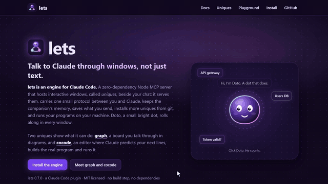
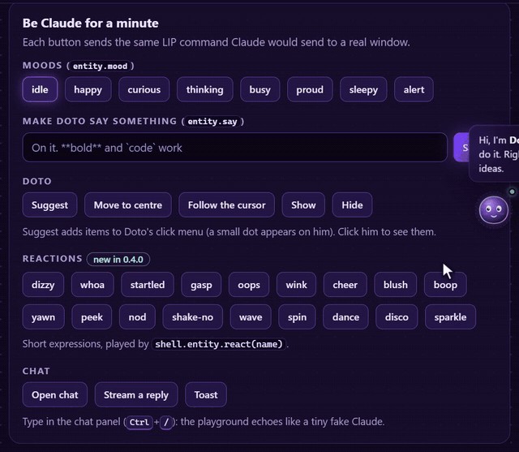

<p align="center"></p>

<p align="center">
  <a href="https://lets.offensiveadhd.com/"></a>
  
  <a href="#license"></a>
</p>

<p align="center"><b>Talk to Claude through windows, not just text.</b><br>The public website for <a href="https://github.com/offensiveadhd/lets">lets</a>, published with GitHub Pages as a project site at <b><a href="https://lets.offensiveadhd.com/">https://lets.offensiveadhd.com/</a></b>. Plain HTML, one CSS file and a few ES modules. No build step, no bundler, no CDN, no web fonts from the network, no analytics.</p>

<p align="center">
  <a href="#see-it-run">See it run</a> ·
  <a href="#play-with-doto">Play with Doto</a> ·
  <a href="#what-is-here">What is here</a> ·
  <a href="#preview-locally">Preview locally</a> ·
  <a href="#rules-for-editing">Rules for editing</a> ·
  <a href="#updating-the-vendored-sdk">Updating the vendored SDK</a> ·
  <a href="#publishing">Publishing</a> ·
  <a href="#license">License</a>
</p>

## See it run

<p align="center">
  <a href="assets/readme/site.mp4"></a>
</p>

One real take of this site, served from a checkout by a small static server and recorded in a headless
browser. The hand is a script: it clicks Doto in the hero, scrolls the landing page, copies the install
prompt and opens the Uniques page. The pages are static, so there is no host and no Claude in it. The arrow
is the recorder's, everything else is the page. Select the picture for the
[full take](assets/readme/site.mp4), which goes on to the playground. How it was recorded is in
[lets/promo](https://github.com/offensiveadhd/lets/tree/main/promo).

## Play with Doto

<p align="center">
  <a href="https://lets.offensiveadhd.com/playground.html"></a>
</p>

The same take, cut to the controls of [the playground](https://lets.offensiveadhd.com/playground.html).
Select the picture to open it live.

`playground.html` is the real shell from `lets/sdk`, running on an offline loopback: no host, no Claude,
nothing leaves the page. Doto rolls after your pointer. Each button sends the same LIP command Claude would
send to a real window: eight moods with `entity.mood`, a line of speech with `entity.say`, suggestions for
his click menu. Eighteen reactions play through `shell.entity.react(name)`. Click him for his menu,
right-click anywhere to summon or dismiss him, and press Ctrl+/ for the chat, where the playground echoes
like a tiny fake Claude. "The wire", beside the buttons, lists every command sent down and every event the
window would send up to Claude. Pointer moves never appear there: only meaning crosses.

<details>
<summary>How the playground runs with no host</summary>

`js/playground.js` mounts the vendored shell on a real `Lets` client whose network legs are stubbed:

- It never calls `lets.open()`, so there is no EventSource and no fetch. The queue that would be POSTed to
  the host is emptied instead, and an upload returns a made-up result.
- A button's command is dispatched exactly as the host would deliver it:
  `lets._dispatch({lip:1, id, ts, dir:'down', from:'claude', type, data})`.
- Every event the shell emits is shown in "the wire" instead of being sent.
- A tiny fake Claude answers four of them. A click on Doto (`entity.click`) gets two suggestions
  (`entity.suggest`). Picking one of those (`entity.pick`) gets a line from him (`entity.say`). A chat
  message (`chat.message`) gets a streamed echo (`chat.say`). A found secret (`entity.secret`) gets a toast.

</details>

## What is here

```
index.html            landing page: the engine first (hero with Doto, what the engine does),
                      graph + cocode as the two showcase uniques, install prompt, screenshots
uniques.html          graph + cocode + den + mors + pulse with their install lines, defaults vs the store, proposed next
playground.html       the real lets shell on an offline loopback: moods, reactions, chat
404.html              self-contained (inline CSS), works at any depth
docs/                 index, getting-started, companion, uniques, graph, den, cocode, mors, protocol, architecture
css/site.css          the only stylesheet (deep-violet theme variables from lets/sdk/lets-shell.css)
js/site.js            nav toggles, copy buttons, the hero orb, anchors
js/playground.js      mounts the shell with a stub transport
sdk/                  vendored copies of lets/sdk/lets-client.js, lets-shell.js, lets-shell.css
assets/               logo, graph + den + cocode + mors + pulse icons, screenshots
assets/banner.svg     the banner at the top of this README
assets/readme/        site.gif, playground.gif, site.mp4: the recordings this README shows
.nojekyll             tells Pages to serve files as-is (no Jekyll)
```

`assets/banner.svg` and `assets/readme/` are for this README: no page uses them. Pages publishes the whole
branch, so they are on the web as well, and they are kept small for that reason.

## Preview locally

From this folder:

```bash
python -m http.server 8765
# or
npx serve -l 8765 .
```

Then open http://127.0.0.1:8765/. Pages use ES modules, so open them through a
server, not straight from disk (`file://`).

## Rules for editing

- **Every path is relative** (`./x`, `../x`), never root-absolute (`/x`): the
  site lives under `/lets-site/` on Pages. Check before pushing:

  ```bash
  grep -rnE '(href|src)="/|url\(/' .
  ```

  It must print nothing. The check reads every file in the folder, this README
  included.
- Theme colours come from the `:root` block of `lets/sdk/lets-shell.css`.
  Keep body text at 4.5:1 contrast or better, respect
  `prefers-reduced-motion`, keep everything keyboard-reachable, give images
  alt text, and check 375 px width (no horizontal scroll).
- Claims stay honest: only what the lets repos and the current release do.
  Features that land with a release are marked "new in 0.4.0".

## Updating the vendored SDK

The playground runs the real shell. When `lets/sdk` changes, copy the three
files over:

```bash
cp ../lets/sdk/lets-client.js ../lets/sdk/lets-shell.js ../lets/sdk/lets-shell.css sdk/
```

The playground links `./sdk/lets-shell.css` itself, so the shell never tries
to inject its default root-absolute `/sdk/lets-shell.css`, and it never calls
`lets.open()`, so nothing is fetched. Reaction buttons light up automatically
once the vendored shell has `shell.entity.react` (lets 0.4.0).

## Publishing

GitHub Pages, "Deploy from a branch": branch `main`, folder `/ (root)`.
Pages serves `index.html` at the root and `404.html` for missing paths.
`.nojekyll` keeps Pages from running Jekyll.

## License

MIT © offensiveadhd
